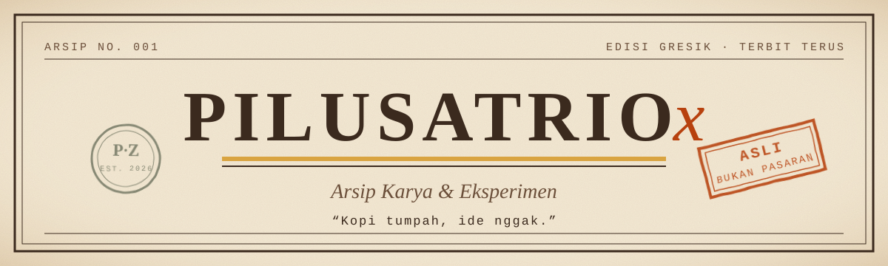

<div align="center">




</div>

---

### Perihal

Pembuat web dan eksperimen AI dari Gresik. Suka tampilan yang hangat,
berkarakter, dan terasa seperti barang cetakan lama, bukan template pasaran.

---

### Daftar Isi Karya

```
No. 01   PILUSZERO Web Frontier Atlas ............ atlas teknologi web
No. 02   SATRI-1B ................................ model AI buatan sendiri
No. 03   PILUSTRADE ............................... AI Futures Desk
No. 04   PILUSENSIKLOPEDIA ....................... ensiklopedia pribadi
No. 05   PILUSBOOTH .............................. studio potret digital
No. 06   PILUS BROWSER ........................... tema Day/Night/Sepia/Rust
```

**01 · PILUSZERO Web Frontier Atlas**
Atlas interaktif teknologi web modern untuk developer, dijaga oleh chatbot
"Sang Penjaga PILUSZERO" yang bertutur ala Jawa kuno.

**02 · SATRI-1B**
Model AI sendiri, fine-tuned dari Qwen3-1.7B, dengan Web UI chat yang
filosofis dan anti-pasaran.

**03 · PILUSTRADE**
Meja futures bertenaga banyak agent AI untuk Binance Futures, disetel
untuk scalping cepat.

**04 · PILUSENSIKLOPEDIA**
Ensiklopedia pribadi yang entrinya terus bertambah.

**05 · PILUSBOOTH**
Studio Potret Digital, terhubung ke Firebase.

**06 · PILUS BROWSER**
Peramban dengan empat suasana: Day, Night, Sepia, dan Rust.

---

### Perkakas

`HTML` · `CSS` · `JavaScript` · `Firebase` · `Python` · `Qwen3`

### Surat-menyurat

[github.com/PILUSATRIOx](https://github.com/PILUSATRIOx)

<div align="center">

```
──────────  Dicetak pelan-pelan, diseduh hangat  ──────────
```

</div>
